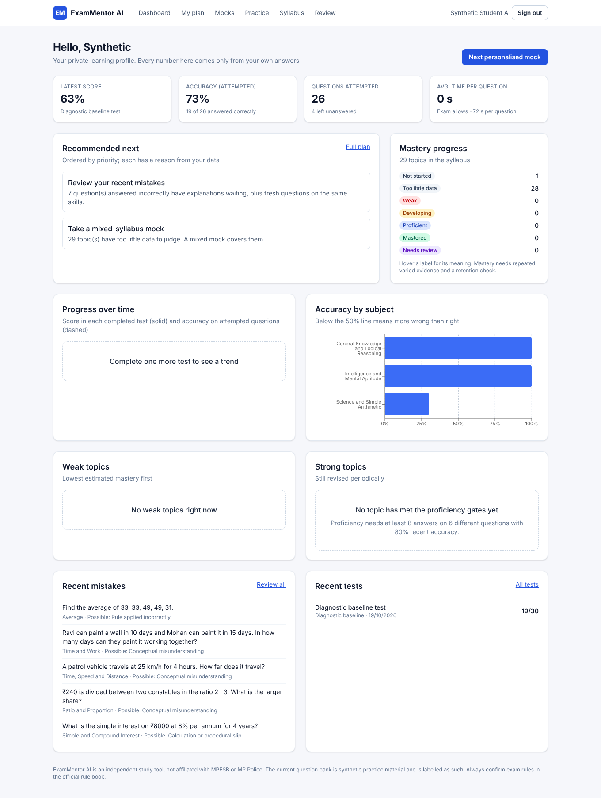
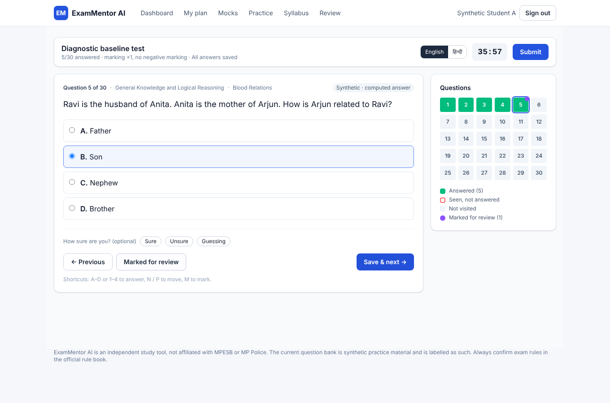
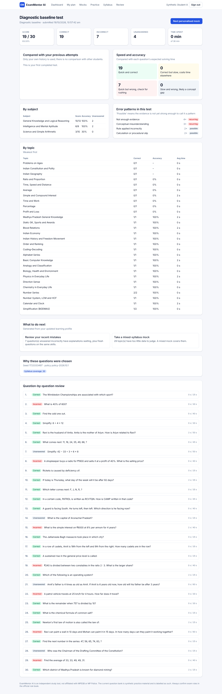
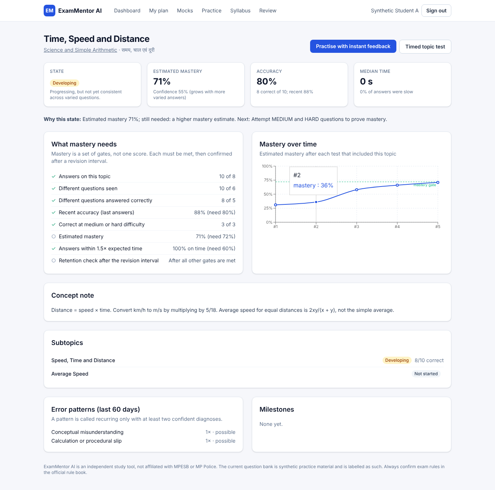
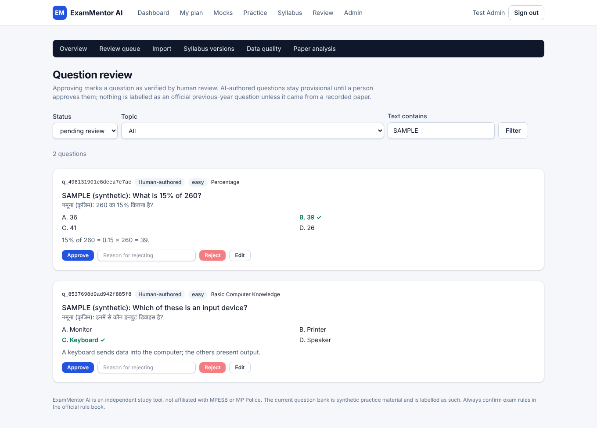
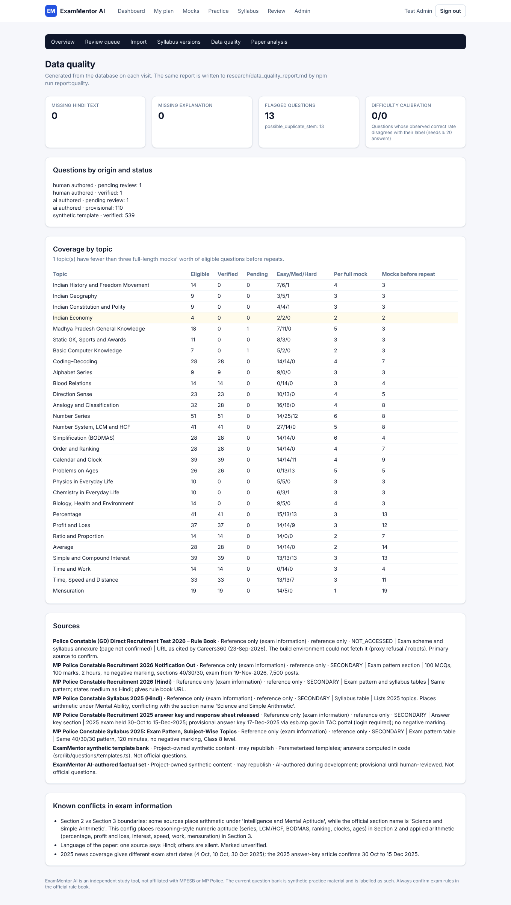

# ExamMentor AI

An adaptive practice and mock-test mentor for the **Madhya Pradesh Police Constable (PCRT-GD 2026)** written exam. It works out which topics each student is weak in, from their own answers, and builds the next mock around those gaps while keeping mastered topics in low-frequency revision.



> **Status:** working software, tested locally (see [Tests](#13-running-tests)). It has **not** been deployed or used by real students. The question bank is synthetic and contains **no official previous-year questions**; see [Known limitations](#18-known-limitations).

---

## 1. What it does

- Gives a new student a **diagnostic mock** covering the whole syllabus in proportion to the exam blueprint.
- Builds a **per-topic and per-subtopic learning profile**: a mastery estimate with confidence, recent accuracy, speed, repeated mistakes, trend and retention dates.
- **Classifies each wrong answer** (concept gap, rule misapplied, calculation slip, misread, rushed, guessing, time management, forgetting) and shows the evidence, marking weak diagnoses as "possible".
- Generates **personalised mocks** whose topic mix, difficulty and question choice follow the profile, and explains why each topic was included.
- Moves topics through clear states (Not started → Too little data → Weak → Developing → Proficient → Mastered → Needs review) using **explicit mastery gates**, so a single lucky score can never mark a topic mastered.
- Gives a **study plan** with ranked recommendations, a **review queue** of wrong answers, a **syllabus explorer**, and optional **tutor explanations**.
- Gives administrators tools to **import and review questions**, version the syllabus, analyse papers and check data quality.

## 2. Why this differs from an ordinary mock series

An ordinary test series gives every student the same paper and a score. ExamMentor AI treats each answer as evidence about a specific skill:

| Ordinary mock | ExamMentor AI |
|---|---|
| Same paper for everyone | Each personalised mock is built from that student's topic states |
| Score and rank | Per-topic mastery, confidence and the reason behind each wrong answer |
| Repeats or ignores weak areas at random | Weak topics get more slots, with **new** questions on the same skills (never the same missed question verbatim) |
| Strong topics keep taking time | Mastered topics drop to low frequency but stay in revision; they come back if performance falls |
| "You got 62%" | "Percentage: weak (38% estimated). 3 of your last 4 misses used the wrong base. Practise these 8 questions." |

In the learner simulation, two synthetic students with different weak areas took the same diagnostic. By their third personalised mock, 23% of student A's questions were on A's weak arithmetic topics (student B: 0%), 40% of student B's were on B's weak GK topics (student A: 13%), and only 13% of the questions overlapped ([docs/simulation_results.md](docs/simulation_results.md)). These are software checks with synthetic learners. **There is no evidence yet that the app improves real students' results.**

## 3. Supported exam

**MP Police Constable (GD and Radio), PCRT-GD 2026, conducted by MPESB.** Configuration version `2026.1` in [`data/exam-config/mp-police-constable-2026.json`](data/exam-config/mp-police-constable-2026.json):

| Item | Value |
|---|---|
| Questions / marks | 100 / 100 (1 mark each) |
| Duration | 120 minutes |
| Negative marking | None |
| Sections | General Knowledge and Logical Reasoning (40), Intelligence and Mental Aptitude (30), Science and Simple Arithmetic (30) |

These values come from consistent secondary sources. **The official MPESB rule book PDF could not be retrieved and verified**, so the configuration is marked `SECONDARY_CONSISTENT`, and the app shows that label. Sources, conflicts and gaps are recorded in [`research/`](research/): [official_sources.md](research/official_sources.md), [exam_pattern.md](research/exam_pattern.md), [syllabus.md](research/syllabus.md). Other exams can be added as new versioned configurations; the code has no MP-specific constants.

## 4. Features

**Students**
- Registration and sign-in (hashed passwords, httpOnly session cookie, rate-limited login).
- Dashboard: readiness by section, topic states, weak areas, recent mocks, next recommended action.
- Eight mock types: diagnostic, full-length (exact exam pattern), subject, topic practice, adaptive weakness, speed drill, revision, mixed.
- Exam interface: timer, question palette, mark for review, save as you go, resume after refresh, server-side time enforcement and auto-submit.
- Results: score, section breakdown, time analysis, error diagnoses with evidence, and the profile change caused by this mock.
- Syllabus explorer with per-topic detail and the mastery gates the student has and has not met.
- Study plan with ranked recommendations and the reason for each.
- Review queue of wrong and skipped answers with explanations.
- Tutor panel (offline by default; optional Claude-powered explanations).
- Account page: export all personal data as JSON, delete the account.

**Administrators** (separate role; the admin area returns 404 to students)
- Import questions from CSV, JSON, text or PDF. Imports are validated, deduplicated, and always land as **pending review**.
- Review queue: approve, reject (with a reason) or edit questions; every action is audited.
- Syllabus versions: upload, validate and activate.
- Paper analysis (with a reliability warning when papers are unverified) and a data-quality report.

| | |
|---|---|
|  |  |
|  |  |
|  |  |

All 15 screenshots are in [`docs/screenshots/`](docs/screenshots/). They were captured by Playwright from the running app with synthetic accounts.

## 5. Stack

- **Next.js 15** (App Router, server components and route handlers), **React 19**, **TypeScript**
- **Tailwind CSS 4**, **Recharts**
- **PostgreSQL 16** with **Prisma 6**
- **zod** validation, **bcryptjs** password hashing
- **@anthropic-ai/sdk** for the optional tutor
- **Vitest** (unit and integration), **Playwright** (end-to-end and screenshots)

Architecture: [docs/architecture.md](docs/architecture.md). Data model: [docs/data-model.md](docs/data-model.md). API: [docs/api.md](docs/api.md).

## 6. Prerequisites

- **Node.js 20 or later** (tested with 22.22) and npm
- **PostgreSQL 14 or later** (tested with 16), either installed locally or via Docker
- Git
- Optional: an Anthropic API key for the AI tutor

## 7. Installation on Windows

Run these in **PowerShell**.

1. **Install Node.js** (LTS) from <https://nodejs.org> and Git from <https://git-scm.com>.
2. **Install PostgreSQL** using one of these:
   - The installer from <https://www.postgresql.org/download/windows/>. Remember the password you set for the `postgres` user. Then create the database:
     ```powershell
     & "C:\Program Files\PostgreSQL\16\bin\createdb.exe" -U postgres exammentor
     ```
   - Or Docker Desktop, then from the project folder: `docker compose up -d` (uses [docker-compose.yml](docker-compose.yml), which creates the `exammentor` database).
3. **Get the code and install dependencies:**
   ```powershell
   git clone https://github.com/pvc2000-creator/exam-mentor-ai.git
   cd exam-mentor-ai
   npm ci
   ```
4. **Create your environment file** and edit `DATABASE_URL` to match your PostgreSQL password:
   ```powershell
   Copy-Item .env.example .env
   notepad .env
   ```
5. **Create the tables and load the syllabus and question bank:**
   ```powershell
   npx prisma migrate deploy
   npm run db:seed
   ```
6. **Create your administrator account** (see [section 10](#10-creating-the-first-admin-securely)):
   ```powershell
   npm run admin:create
   ```
7. **Start the app:** `npm run dev`, then open <http://localhost:3000>.

On macOS or Linux the steps are the same, using `cp .env.example .env`.

## 8. Environment variables

Copy `.env.example` to `.env`. **Never commit `.env`**; it is in `.gitignore`.

| Variable | Required | Purpose |
|---|---|---|
| `DATABASE_URL` | Yes | PostgreSQL connection string |
| `SECURE_COOKIES` | Production | `true` behind HTTPS so the session cookie gets the `Secure` flag |
| `AI_PROVIDER` | No | `none` (default, offline tutor) or `anthropic` |
| `ANTHROPIC_API_KEY` | Only with `anthropic` | Server-side only; never sent to the browser |
| `ANTHROPIC_MODEL` | No | Defaults to `claude-opus-5-5` |
| `ALLOW_PROVISIONAL_QUESTIONS` | No | `true` (default) lets automatically checked, not yet human-reviewed questions appear in mocks, always labelled |
| `MAX_UPLOAD_BYTES` | No | Admin import size limit, default 5 MB |
| `CRON_SECRET` | Production | Bearer token for `POST /api/cron/expire`, which closes overdue attempts |
| `ADMIN_EMAIL`, `ADMIN_PASSWORD`, `ADMIN_NAME` | No | Only read by `npm run admin:create` for non-interactive setup |
| `TEST_DATABASE_URL`, `E2E_DATABASE_URL` | No | Override the test databases (defaults `exammentor_test`, `exammentor_e2e`) |

## 9. Database and migrations

- Schema: [`prisma/schema.prisma`](prisma/schema.prisma). Migrations: [`prisma/migrations/`](prisma/migrations/).
- Apply migrations: `npx prisma migrate deploy` (or `npm run db:migrate` while developing schema changes).
- Seed: `npm run db:seed` loads the exam configuration, syllabus tree and question bank. It is idempotent: questions are matched by a content fingerprint, so running it twice adds nothing.
- Backups and recovery: [docs/backup-recovery.md](docs/backup-recovery.md).

## 10. Creating the first admin securely

There are no default or hard-coded admin accounts, and registration always creates students.

```bash
npm run admin:create                          # prompts for email and password (input hidden)
npm run admin:create -- --promote you@example.com   # make an existing account an admin
```

For scripted setup, set `ADMIN_EMAIL` and `ADMIN_PASSWORD` in the environment for that one command only. Passwords must be at least 12 characters with letters and numbers. The password is never printed, and the action is written to the audit log.

## 11. Importing data

**Questions**, from the command line:

```bash
npm run import:questions -- data/samples/questions-sample.csv --dry-run   # validate only
npm run import:questions -- data/samples/questions-sample.csv --topic ar-percentage
```

Or in the browser at **Admin → Import** (CSV, JSON, TXT or PDF up to `MAX_UPLOAD_BYTES`; the format is checked by content, not just the extension). Every imported question is validated (four distinct options, exactly one correct answer, known topic), checked for duplicates, and stored as **pending review**. Nothing imported reaches students until an admin approves it. Imported questions are never labelled as official previous-year questions unless an admin marks the source paper as verified.

Sample files: [`data/samples/`](data/samples/). Formats and licensing: [research/data_sources.md](research/data_sources.md), [docs/data-licensing.md](docs/data-licensing.md).

**Reports:**

```bash
npm run report:quality     # writes research/data_quality_report.md
npm run analyze:papers     # writes research/paper_analysis.md
```

## 12. Starting the development server

```bash
npm run dev          # http://localhost:3000
```

Production build: `npm run build && npm start`.

## 13. Running tests

Unit and integration tests need PostgreSQL. The integration tests use a **separate** database (`exammentor_test`) that they empty and reseed on every run; create it once with `createdb exammentor_test`. They refuse to run against a database whose name does not contain `test`.

```bash
npm run typecheck          # TypeScript
npm run test:unit          # engine logic: scoring, errors, mastery, allocation, selection, parsers, tutor
npm run test:integration   # API and server code against a real database, including cross-student access
npm test                   # both

createdb exammentor_e2e    # once
npm run build
npm run test:e2e           # Playwright: full student journey, second-student isolation, admin flow
npm run screenshots        # same run, also saves docs/screenshots/*.png

npm run simulate:learners  # synthetic learners; writes docs/simulation_results.md
npm run loadtest           # bulk history + timings; writes docs/load_test_results.md
```

Results from the last run (19 October 2026, Linux, Node 22, PostgreSQL 16):

| Suite | Result |
|---|---|
| Type check | clean |
| Unit (Vitest) | 70 / 70 passed |
| Integration (Vitest) | 33 / 33 passed (run twice in a row) |
| End-to-end (Playwright) | 4 / 4 passed |
| Learner simulation | scenarios H, I, J, K and profile isolation passed |
| Load test | 100 students, 106,589 stored answers: dashboard p50 11 ms, mock generation p50 42 ms ([details](docs/load_test_results.md)) |

The load test runs the server functions sequentially in one process. It shows the queries stay fast with a large history; it does **not** demonstrate behaviour under many concurrent users.

## 14. Generating and completing mocks

1. Register, then open **Mocks**.
2. Start with the **Diagnostic** (30 questions across the syllabus). Personalised types unlock their full effect once there is a baseline.
3. Pick a type. Each mock shows its allocation: how many questions per topic and why.
4. In the exam view, answer, mark for review, and move with the palette. Answers save as you go; a refresh resumes where you were. The timer is enforced on the server, and an overdue attempt is submitted automatically.
5. Submit to see results, error diagnoses and how your profile changed. Then follow the **Plan** or the **Review** queue.

Mock types: Diagnostic, Full-length (100 questions, 120 minutes, 40/30/30), Subject, Topic practice, Adaptive weakness, Speed drill, Revision, Mixed.

## 15. How the adaptive engine works

Full description: [docs/learning-engine.md](docs/learning-engine.md). All thresholds are in [`src/lib/engine/policy.ts`](src/lib/engine/policy.ts), and each mock records the policy version it used.

1. **Profile.** For every topic and subtopic, the engine computes from raw responses a mastery estimate (a Beta posterior weighted by recency and difficulty) with a confidence value, recent accuracy, speed, repeated mistakes, trend and retention dates.
2. **States and gates.** A topic is *Mastered* only after **all** gates pass: at least 8 answers, 6 different questions, 5 different questions correct, recent accuracy ≥ 80%, at least 3 correct at medium or hard, estimate ≥ 72%, not too many slow answers, and then a correct retention check at least 7 days later. A mastered topic goes to *Needs review* after 30 idle days or if recent accuracy falls below 60%.
3. **Error classification.** Each wrong answer is scored against possible causes using the chosen option's misconception tag, time against the expected time and the student's own pace, prior accuracy and history. Low-confidence diagnoses are shown as "possible", and a pattern is only called recurring with repeated evidence.
4. **Allocation.** Each topic gets a category (remediation, repeated errors, speed/accuracy, confirmation, spaced revision, maintenance, coverage). Its weight is *mock-type priority × need × √(syllabus weight)*, and questions are apportioned by weight with a 30% cap per topic.
5. **Selection.** Unseen questions come first. Nothing seen in the last 3 days is reused, and a missed question is never repeated verbatim for remediation. The difficulty mix follows the topic state, skills are spread, and shortages are recorded and filled from the same section.
6. **Recommendations.** Each submission produces ranked next steps with data-based reasons. These work without any AI provider.

## 16. Optional AI configuration

The tutor works **offline by default**. It shows the stored explanation, why the chosen option was wrong, the concept note, and a fresh practice variant generated from the same template.

To enable Claude-powered explanations, set this in `.env`:

```
AI_PROVIDER="anthropic"
ANTHROPIC_API_KEY="sk-ant-..."
# ANTHROPIC_MODEL="claude-opus-5-5"   (default)
```

- The key is read only on the server, in [`src/lib/server/tutor.ts`](src/lib/server/tutor.ts).
- The tutor is only available for questions the student has already answered and seen feedback for, so it cannot be used to get answers during a live mock.
- Requests are rate-limited to 20 per 10 minutes per student.
- If the model refuses, returns nothing, or gives an answer that contradicts the stored correct option, the app falls back to the offline explanation.
- Requests enable server-side model fallbacks, so an overloaded model is retried on a fallback model by the API.

AI-generated content is labelled, and no AI-generated question is ever presented as an official previous-year question. No claim is made that AI explanations improve learning outcomes.

## 17. Deployment

**Not deployed yet.** [docs/deployment.md](docs/deployment.md) covers a Vercel or Node host with managed PostgreSQL (for example Supabase or Neon):

- Set the environment variables, with `SECURE_COOKIES="true"`.
- Run `npx prisma migrate deploy` and `npm run db:seed`.
- Create the admin with `npm run admin:create`.
- Schedule `POST /api/cron/expire` with `Authorization: Bearer $CRON_SECRET`.

Troubleshooting: [docs/troubleshooting.md](docs/troubleshooting.md).

## 18. Known limitations

- **Exam pattern not verified against the official rule book.** The MPESB PDF could not be retrieved; values come from consistent secondary sources and are labelled as such.
- **Synthetic question bank.** There are 650 questions:
  - 539 are generated from verified templates whose answers are computed.
  - 110 are AI-authored GK and science items, marked *provisional*. They passed automated checks but have **not had human review**.
  - 1 is pending review.
  - There are **no official previous-year questions**, and no verified papers, so paper analysis is indicative only.
- **Thin topics.** Indian Economy has fewer questions than the target; see [research/data_quality_report.md](research/data_quality_report.md).
- **No evidence of learning gains.** The adaptive behaviour is verified with simulated learners only.
- **Concurrency not tested.** Load testing measured large histories with sequential requests, not many simultaneous users. Rate limiting is in-memory, per server instance.
- **Language.** Questions support Hindi and English text, but most of the bank is English only, and the UI is English.
- **Not deployed**, and no email verification or password-reset email.
- No licence file is included yet; the owner should choose one before accepting contributions.

## 19. Roadmap

1. Verify the exam pattern against the official MPESB rule book once it can be retrieved.
2. Human review of the 110 provisional questions; source licensed or official previous-year papers.
3. Full Hindi content and a Hindi UI.
4. Pilot with a small group of consenting students, and measure the outcomes before making any claim about them.
5. Concurrency load test against a deployed instance; shared rate-limit store such as Redis.
6. Email verification and password reset.
7. Recalibrate difficulty from observed correct rates once questions have enough answers.
8. Support for further exams through new configuration versions.

---

Privacy: students can export or delete their data from the Account page. Seed data, tests and screenshots use only synthetic accounts on the reserved `example.invalid` domain.
